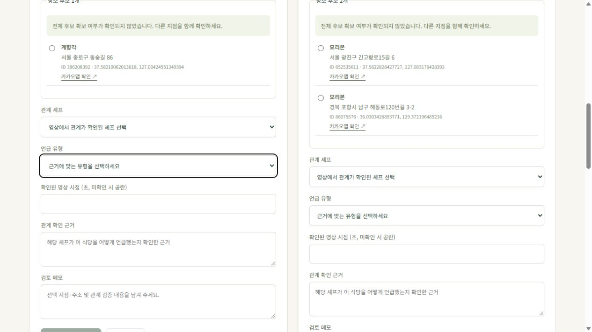

# 추출 후보와 Mention 분리

작업일: 2026-10-22. `AGENTS.md`, `DOMAIN_MODEL.md` 기준.

## 결과

설명란 추출은 RestaurantCandidate만 생성한다. Kakao 검색은 이 후보의 장소 스냅샷과 매칭 상태만 변경한다. 관리자가 셰프·장소·언급 유형·확인 근거·검토 메모를 제출했을 때 별도 Mention을 생성한다.

| 구분 | 저장 위치 | 의미 |
| --- | --- | --- |
| 영상에서 추출한 식당 후보 | restaurant_candidates | 출처 원문·추출 위치·주소·매칭 결과·후보 처리 상태 |
| Kakao 검색 후보 | place_candidates | RestaurantCandidate에 속한 실제 장소 검색 스냅샷 |
| 셰프–식당–영상 관계 | mentions | 세 FK 필수, 언급 유형·확인 시점·관계 검증 상태·검토자·근거 |
| 기존 V1 자료 | legacy_mention_candidates | 이전 원문과 상태·검토 메모를 보존하는 읽기 전용 이력 |

같은 후보는 여러 셰프의 Mention을 지원한다. 같은 셰프·식당·영상·언급 유형은 중복 생성할 수 없다. 후보 행 잠금과 DB UNIQUE 제약을 함께 사용한다. OPEN 후보를 제외하면 DISMISSED이며 Mention은 만들지 않는다. 관계를 승인한 후보는 RESOLVED가 되지만 추가 셰프 관계는 등록할 수 있다. RESOLVED 자체는 공개 조건이 아니며 공개 API는 APPROVED Mention만 사용한다.

장소 MATCHED는 추천/방문/단골 확인을 뜻하지 않는다. 언급 유형은 기본값이 없고 관리자 선택을 요구한다. 관계 근거는 추출 원문과 별도로 작성한다. 미확인 영상 시점은 NULL, 확인된 0초는 0으로 구분한다. 공개 영상 링크에도 확인된 시점만 넣는다. 내부 근거·검토 메모는 관리자 API에만 포함한다.

## 실제 데이터 이관

개발 DB의 변경 전 상태를 확인하고 서버를 멈춘 뒤 승인 0건을 재확인했다. SQL 백업을 `results/before-candidate-separation.sql`에 바이트 그대로 저장했다(Git 제외).

적용된 V1은 수정하지 않고 `V2__separate_candidates_and_mentions.sql`을 추가했다. 개발 DB에서 실제 적용과 JPA 스키마 검증을 완료했다.

| 자료 | 전환 전 | 전환 후 |
| --- | --- | --- |
| Video | 6 | 6 |
| 설명란 추출 후보 | 기존 mentions의 PENDING 3개 | restaurant_candidates 3개 |
| 실제 Mention | 후보와 혼재, 승인 0개 | 별도 mentions 0개 |
| Kakao 스냅샷 | 4 | 4 |
| V1 이력 보관 | 기존 mentions | legacy_mention_candidates 3개 |
| ImportJob | 없음 | 기존 영상 성공 이관 기록 6개 |

후보 ID와 원문을 보존했다. 미제공 주소는 NULL, 수동 추출의 기존 0행은 NULL로 정규화한다. 기존 REJECTED 자료는 DISMISSED 후보로 옮기고 원래 메모는 유지한다. SQL 대조에서 실제 후보 3개의 영상 ID·상호·주소·행·근거가 원본과 일치함을 확인했다.

이전 스냅샷은 전체 검색 여부가 저장되지 않아 자동 MATCHED를 추정하지 않는다. 스냅샷이 있으면 REVIEW_REQUIRED로 시작하고 전체 확보 여부는 미확인으로 표시한다. 재검색 시에만 현재 응답으로 상태를 평가한다. API 실패 시 이전 성공 상태·스냅샷을 보존하고 안전한 `EXTERNAL_API_FAILURE`를 따로 저장한다. 실패를 NOT_FOUND로 기록하지 않는다.

기존 APPROVED 자료에는 언급 유형이 없으므로, 그런 데이터가 있는 환경에서는 V2가 어떤 변경도 하기 전에 중단한다. 유형과 재검증 방침을 명시한 별도 이관이 필요하다. 이번 개발 DB는 승인 0개여서 이 중단 조건에 해당하지 않았다. 실제 식당을 자동 승인하지 않았다.

## 필요한 지원 모델과 범위

- ImportJob: 후보 출처 FK를 위해 성공한 수집과 기존 영상의 성공 이관 기록을 저장한다. 아직 실패 작업 추적·재시도 수명주기를 구현한 것은 아니다.
- AdminUser: 검토자의 실체를 FK로 보존하기 위해 DB 계정과 BCrypt 해시를 사용한다. 최초 환경변수 계정만 생성하며 기존 비밀번호는 재시작으로 덮어쓰지 않는다. 계정 관리 화면은 없다.
- 후보와 관계 API/화면을 함께 변경했다. 이전 `/admin/mentions/{id}/places`, `/approve`, `/reject`는 사용하지 않고 README의 새 후보 API를 사용한다.
- 프론트엔드는 기존 화면 구조에서 분리에 필요한 부분을 수정했다. TypeScript 등 전체 프론트엔드 기반 전환은 별도 단계다.

## 검증

| 검증 | 결과 |
| --- | --- |
| 백엔드 통합·추출·매칭·마이그레이션 | 33개 통과, 실패·오류·건너뜀 0개 |
| 프론트엔드 | 9개 통과 |
| 기존 Python PoC | 30개 통과 |
| 합계 | **72개 통과** |
| 실행 JAR / 프론트엔드 빌드 | 성공 |
| 실제 관리자 로그인 및 API | 영상 6·후보 3·Mention 0·공개 식당 0 확인 |
| 브라우저 | 보존된 장소 후보 표시, 언급 유형 미선택, 시점 공란, 근거 미입력 상태에서 승인 차단 확인 |

주요 회귀: 추출 시 Mention 미생성, 장소 MATCHED여도 미승인, 한 후보에서 두 셰프 관계, 후보가 달라도 동일 관계 중복 차단, 후보/관계 FK, 관계 승인 시 유형·근거·검토자 필수, 미확인과 0초 구분, API 실패 시 이전 결과 보존, 제외 시 관계 미생성, 후보 RESOLVED여도 미승인 관계는 비공개, 인증/CSRF, 빈 검색, 동명 지점·부번 차이, V1→V2 원문 보존·이력 변경 차단·기존 승인 중단.

본문 없는 201 응답도 성공으로 처리하도록 클라이언트를 보완하고 별도 API 계약 테스트를 추가했다. 후보·관계 생성 후 JSON 파싱 오류로 화면이 갱신되지 않는 경우를 방지한다.

실제 개발 DB에서는 원문과 기존 검색 스냅샷을 읽어 확인했다. 이 작업의 화면 검증에서는 외부 장소 API를 다시 호출하거나 실제 관계를 승인하지 않았다. 테스트의 승인 자료는 임시 PostgreSQL에서만 생성하고 정리했다.

재현 명령과 API는 [README](../README.md)에 기록했다. 사용자 승인에 따라 장소 매칭, 백엔드 분리, 응답 처리, 관리자 화면, 실서버 검증, 문서 단위로 커밋한다. 원격 푸시는 수행하지 않는다.
