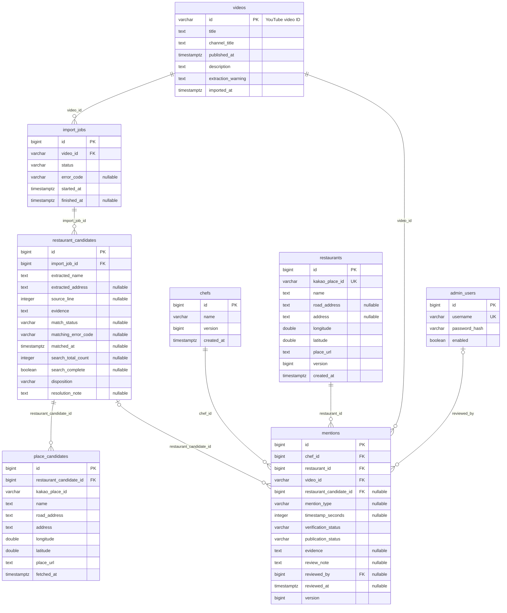
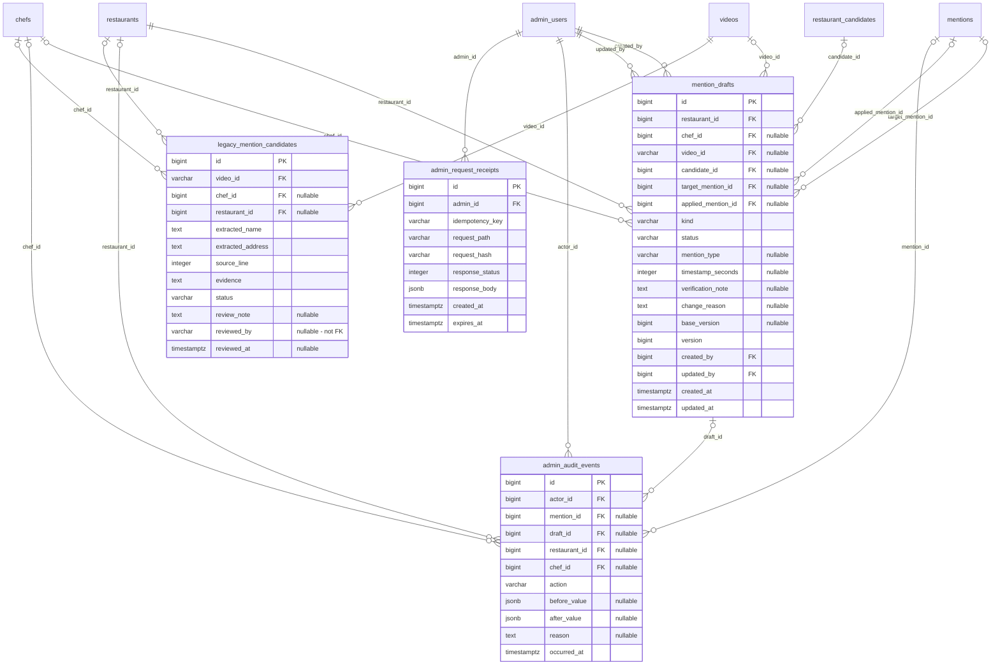

# 현재 DB 구조 ERD

작성일: 2026-11-04. V1~V3 Flyway SQL을 순서대로 반영한 구조이며 JPA 엔티티와 대조했다. 실제 DB 접속·Flyway 적용 이력 확인은 수행하지 않았다. Flyway 자체 이력 테이블은 제외한다.

이 문서는 현재 DDL의 12개 업무 테이블을 나타낸다. `DOMAIN_MODEL.md`의 향후 설계와 구분하며, 주요 컬럼만 표시한다. PK는 기본 키, FK는 외래 키, UK는 단일 컬럼 유일 키다. `||`는 필수 부모 1개, `o|`는 선택 부모 0~1개, `o{`는 자식 0~여러 개다. 선택 여부는 DB의 NULL 허용 기준이며 상태별 CHECK가 추가로 제한할 수 있다.

## 수집·장소·근거 관계

`mentions`가 셰프·식당·영상의 근거 관계다. 후보 하나가 여러 셰프의 관계를 뒷받침할 수 있다. `place_candidates.kakao_place_id`와 `restaurants.kakao_place_id` 사이에는 DB FK가 없다. 장소 검색 스냅샷과 확정 식당을 구분한다.

## 초안·감사·멱등·보존 자료

아래 그림에서 앞 그림의 테이블을 다시 참조한다. V3의 초안·감사·멱등 테이블 존재는 대응 API 전체 구현을 의미하지 않는다. 현재 JPA 엔티티는 앞 그림의 8개 테이블에 있다.

## 주요 제약과 상태

| 대상 | 현재 DDL 규칙 |
| --- | --- |
| 셰프 | 이름은 공백 불가, 최대 100자. V3에서 UNIQUE 제거: 동명이인 허용 |
| 식당 | Kakao Place ID 유일. 경도 -180~180, 위도 -90~90. 주소 NULL 허용 |
| 관계 중복 | `UNIQUE(chef_id, restaurant_id, video_id)`: 언급 유형이 달라도 중복 불가 |
| 관계 승인 | `APPROVED`이면 유형·승인 관리자·승인 시각 필수 |
| 관계 공개 | `PUBLISHED`이면 `APPROVED` 필수. 실제 공개 조회도 두 조건을 함께 적용 |
| 언급 유형 | `REGULAR / RECOMMENDED / VISITED / MENTIONED` |
| 관계 검증 / 공개 | `PENDING / APPROVED / REJECTED`와 `PUBLISHED / SUSPENDED`는 독립 컬럼 |
| 시점 | NULL은 미확인, 0은 확인된 0초. 음수 불가 |
| 관계 근거·메모 | V3 DB에서는 NULL 허용. evidence는 값이 있으면 공백 불가. 현재 후보 기반 승인 코드는 비어 있지 않은 evidence 요구 |
| 수집 작업 | `PENDING / RUNNING / SUCCEEDED / FAILED` |
| 추출 후보 중복 | `UNIQUE NULLS NOT DISTINCT(import_job_id, source_line, extracted_name)` |
| 후보 매칭 / 처리 | `MATCHED / REVIEW_REQUIRED / NOT_FOUND`와 `OPEN / RESOLVED / DISMISSED`는 별개. 매칭 상태 NULL 허용 |
| 장소 후보 중복 | `UNIQUE(restaurant_candidate_id, kakao_place_id)` |
| 초안 종류 | `CREATE`: 대상 관계·기준 버전 없음. `CORRECTION`: 대상 관계·기준 버전·공백 아닌 변경 사유 필수 |
| 초안 상태 | `DRAFT`: 반영 관계 없음. `APPLIED`: 반영 관계·셰프·영상·유형 필수 |
| 정정 초안 중복 | 같은 대상 관계의 `CORRECTION AND DRAFT`는 부분 UNIQUE 인덱스로 1개만 허용 |
| 감사 | 대상 FK 4개 중 최소 1개 필수. 트리거로 UPDATE/DELETE 차단 |
| 멱등 | `UNIQUE(admin_id, idempotency_key)`, 64자리 소문자 16진 요청 해시, 2xx 응답, 만료 시각은 생성 이후 |
| 보존 자료 | V1 mentions를 V2에서 `legacy_mention_candidates`로 변경. 트리거로 INSERT/UPDATE/DELETE 차단 |
| FK 삭제 정책 | 명시적인 ON DELETE CASCADE 없음. 기본 NO ACTION 적용 |

주요 조회 인덱스는 셰프 이름, 작업별 후보, 후보별 관계, 식당·검증 상태별 관계, 영상별 관계, 공개 관계 부분 인덱스, 식당·상태·수정일별 초안, 관계/식당별 감사 시각, 멱등 기록 만료 시각이다.

## 설계 문서와의 차이 및 근거

- `DOMAIN_MODEL.md`의 `RestaurantRevision`, `ChefRevision`, 영상의 `source_check_status/source_checked_at`은 V1~V3 DDL에 없다. 이번 ERD에서 제외했다.
- 현재 DDL에는 도메인 문서의 주요 필드 그림에 생략된 `mention_drafts.applied_mention_id/updated_by`, `admin_request_receipts`, legacy 보존 테이블 등이 있다.
- 일반 사용자·소셜 계정·저장·제보 테이블은 현재 V1~V3에 없다.
- 실제 대상 DB의 적용 버전·추가 객체·데이터 정합성은 미확인이다.

근거:

- [V1 초기 스키마](../backend/src/main/resources/db/migration/V1__initial_schema.sql)
- [V2 후보와 관계 분리](../backend/src/main/resources/db/migration/V2__separate_candidates_and_mentions.sql)
- [V3 직접 등록 기반](../backend/src/main/resources/db/migration/V3__prepare_direct_registration.sql)
- [JPA 관계 엔티티](../backend/src/main/java/kr/sedanji/mention/MentionEntity.java)
- [공개 식당 조회](../backend/src/main/java/kr/sedanji/restaurant/RestaurantRepository.java)
- [도메인 설계](DOMAIN_MODEL.md)
- [요구사항](REQUIREMENTS.md)

문서 생성만 수행했으며 앱 빌드·테스트·DB 실행은 수행하지 않았다.
