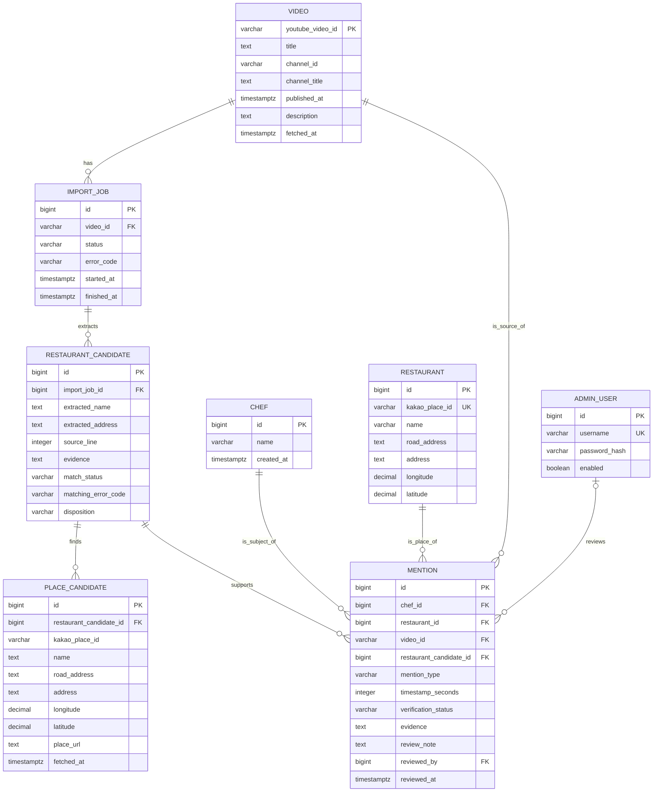

# 세단지 도메인 설계 — 1단계

작성일: 2026-10-22. 기준: 루트 `AGENTS.md` 5~8절.

이 문서는 목표 모델이다. 최초 작성 단계에서는 DB를 변경하지 않았으며, 아래 구현 현황과 구분한다.

## 구현 현황 — 후보와 관계 분리 반영

2026-10-22 V2에서 RestaurantCandidate와 Mention을 실제 테이블·엔티티·API로 분리했다. PlaceCandidate는 추출 후보에 연결하며, 한 후보에서 여러 셰프의 Mention을 생성할 수 있다. Mention의 셰프·식당·영상 필수 조건, 언급 유형·시점·검증 상태·AdminUser 검토자 FK를 반영했다. 후보의 성공한 수집 출처를 연결하기 위한 ImportJob과 DB 기반 관리자도 추가했다.

기존 개발 DB에는 승인된 관계가 없어 후보 3개를 이관했다. 기존 승인 데이터가 있는 다른 환경은 유형을 추정하거나 비공개로 바꾸지 않고 마이그레이션을 중단한다. [분리·검증 기록](CANDIDATE_MENTION_SEPARATION.md).

아래 ERD의 모든 후속 요구가 완료된 것은 아니다. ImportJob의 실패·재시도 수명주기, 관계 초안·승인 취소 UI, 동명이인 셰프 등록, 기본 정보의 추가 필드와 정밀도 정리는 후속 범위다.

## 관계 ERD

PlaceCandidate는 Kakao 검색 결과 스냅샷을 담는 보조 모델이다. 설명란에서 추출한 후보인 RestaurantCandidate와 구분한다.

## 필드와 제약조건

| 모델 | 필수 조건과 설계 방침 |
| --- | --- |
| Chef | 이름 필수. 동명이인을 고려해 이름만으로 UNIQUE를 걸지 않는다. 등록 시 기존 셰프를 보여주고 관리자가 동일인 여부를 판단한다 |
| Restaurant | Kakao Place ID는 NOT NULL / UNIQUE. 이름 필수. 미제공 주소는 NULL. 경도는 -180~180, 위도는 -90~90의 유한값. 카카오맵 URL은 검증된 ID에서 생성할 수 있다 |
| Video | 11자리 YouTube videoId가 PK. 영상 URL은 ID에서 생성한다. 채널 ID와 표시명을 저장하며 Chef와 자동 연결하지 않는다. 빈 설명란도 정상 조회 결과로 보관한다 |
| ImportJob | 대상 Video가 확인된 뒤 생성. 상태는 PENDING / RUNNING / SUCCEEDED / FAILED. 시작·종료 시각과 안전한 오류 분류를 보관한다. 초기에는 동기 처리하며 별도 큐를 도입하지 않는다 |
| RestaurantCandidate | 설명란 근거와 추출 위치를 보관한다. 주소 불명은 NULL. 자동 추출은 source_line >= 1, 수동 추가는 NULL. import_job_id에 인덱스. 수동 근거는 저장된 설명란과 대조한다 |
| PlaceCandidate | (restaurant_candidate_id, kakao_place_id)는 UNIQUE. 클라이언트의 임의 좌표 대신 공식 API의 검증된 스냅샷을 사용한다 |
| Mention | Chef / Restaurant / Video는 NOT NULL. 후보에서 생성했다면 restaurant_candidate_id를 보관한다. 같은 후보가 여러 셰프의 근거일 수 있어 후보와는 1:N 관계. 출처·셰프·장소·언급 유형 조합에 UNIQUE를 걸어 중복 승인을 막는다 |
| AdminUser | username은 UNIQUE. 평문 비밀번호 대신 BCrypt 해시와 enabled를 저장한다. 최초 관리자는 환경변수로 명시적으로 생성하며 기존 비밀번호를 재시작마다 덮어쓰지 않는다 |

## 독립적으로 관리할 상태

### 장소 식별

RestaurantCandidate.match_status는 MATCHED / REVIEW_REQUIRED / NOT_FOUND다. 미실행 또는 실패로 결과가 없다면 NULL로 두고 matching_error_code를 별도로 보관한다.

- MATCHED: 이름과 상세 주소가 충분히 일치하고 유력 후보가 유일하다. 후보 목록 조회 완료도 필요하다.
- REVIEW_REQUIRED: 검색은 성공했지만 주소 부재·비교 불가·복수 후보 등으로 검토가 필요하다.
- NOT_FOUND: 정상 검색이 완료됐고 후보가 0개다.
- API 실패: NOT_FOUND로 바꾸지 않는다. 이전 성공 결과가 있다면 조회 시각과 함께 보존하고 재검색 실패를 별도로 표시한다.

disposition은 OPEN / RESOLVED / DISMISSED이며 후보 처리 상황만 나타낸다. RESOLVED 자체는 공개 조건이 아니다.

### 셰프와 식당의 관계

Mention.verification_status는 PENDING / APPROVED / REJECTED다. APPROVED만 공개한다.

mention_type은 REGULAR / RECOMMENDED / VISITED / MENTIONED다. PENDING 초안에서는 미확정(NULL)을 허용한다. 승인할 때 관리자가 근거에 따라 유형을 명시한다. 이름·주소만으로 어떤 유형도 확정하지 않는다. 장소 식별 성공을 셰프의 단순 언급 사실을 확인한 근거로도 사용하지 않는다.

timestamp_seconds는 확인된 경우에만 0 이상의 정수로 저장한다. 미확인은 NULL이며 0초와 구분한다. 설명란에 시점이 없으면 추측하지 않는다.

APPROVED에서는 mention_type, reviewed_by, reviewed_at, 공백이 아닌 review_note와 evidence를 필수로 한다. CHECK 제약과 서비스에서 함께 검증한다. UNIQUE 제약과 낙관적 잠금 또는 행 잠금으로 중복·동시 승인을 막는다.

## 승인 트랜잭션

1. 후보를 잠그고 처리 상태와 선택한 장소가 해당 후보에 속하는지 검사한다.
2. 셰프·출처·언급 유형·근거·장소 확인 내용을 검사한다. MATCHED를 추천 사실 확인으로 대신하지 않는다.
3. Kakao ID로 Restaurant을 조회하거나 생성한다.
4. Mention을 APPROVED로 생성하고 검토자·시각·메모를 저장한다. 후보 처리 상태도 같은 트랜잭션에서 갱신한다.
5. 공개 API는 APPROVED Mention에 연결된 식당·셰프·영상만 반환한다. 내부 후보와 검토 메모는 제외한다.

주소 없는 후보 등을 수동 확인했다면 장소 선택 이유를 메모로 남긴다. 자동 매칭 상태를 임의로 MATCHED로 바꾸지 않는다. 영상 속 관계 확인은 관리자가 수행하며, 시스템이 영상 내용을 확인했다고 표현하지 않는다.

## 마이그레이션과 삭제

- 적용된 `V1__initial_schema.sql`은 수정하지 않는다. 후속 Flyway 파일로 단계적으로 전환한다.
- 현재 mentions에 섞인 미승인 추출 후보는 RestaurantCandidate로 옮긴다. 전환 후 Mention은 Chef / Restaurant / Video의 실제 근거 관계를 나타낸다.
- 기존 승인 데이터에 언급 유형이 없다면 추정하지 않는다. 재검증이 필요하며, 전환 전에 현재 DB 상태를 확인하고 처리 방침을 확정한다.
- 자동으로 공개 승인을 생성하지 않는다. 삭제·비공개 전환 등 영향이 있다면 대상 건수와 전환 내용을 먼저 제시한다.
- 근거와 검토 이력을 보존하도록 참조 중인 Chef / Restaurant / Video / AdminUser의 물리 삭제는 RESTRICT로 막는다. 관리자는 enabled로 비활성화한다.
- ImportJob 실패 시 확인된 영상·후보를 삭제하지 않는다. 재시도에서도 같은 영상이 중복 생성되지 않도록 한다.

분리 범위의 SQL·JPA 매핑·마이그레이션 테스트는 V2와 함께 추가했다. 나머지 목표 모델 차이는 구현 현황에 명시한 후속 범위로 남긴다.
