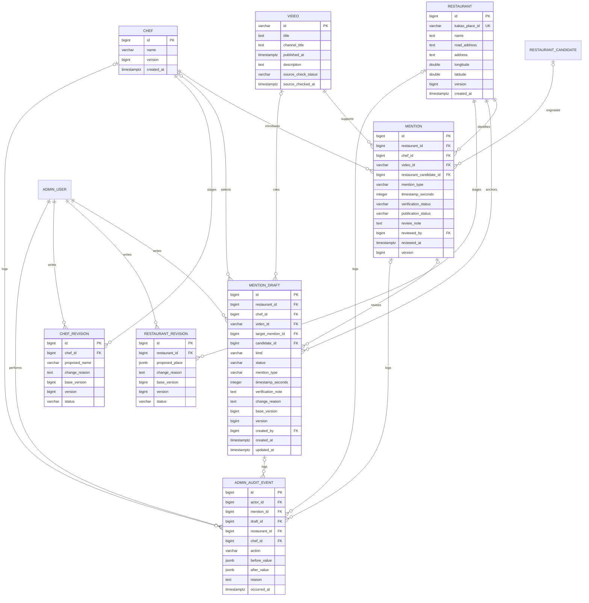

# 세단지 도메인 설계

갱신일: 2026-11-02. 기준: [요구사항](REQUIREMENTS.md), [관리자 구현 계획](ADMIN_IMPLEMENTATION_PLAN.md), AGENTS.md.

이 문서는 관리자 1단계의 **구현 대상 설계**다. 아래 신규 모델·필드·제약은 아직 DB나 실행 코드에 적용되지 않았다. 실제 구현은 V2의 후보·관계 분리까지이며 [이전 설계](archive/DOMAIN_MODEL_V2.md)와 [분리 기록](CANDIDATE_MENTION_SEPARATION.md)을 보존한다. 과거 DB 건수를 현재 상태로 가정하지 않는다.

## 설계 범위

직접 등록·임시 저장·승인, 목록·상세, 정정·공개 중단·복구를 설계한다. 일반 사용자·저장·Submission 테이블은 후속 단계에서 설계한다. 제보 연결은 향후 원본 제보를 보존한 별도 FK로 확장하며 RestaurantCandidate를 사용자 제보로 재사용하지 않는다.

핵심 구분은 다음과 같다.

- Restaurant: 검증된 실제 장소. 존재 자체는 공개 승인이 아니다.
- MentionDraft: 식당만 선택된 미완성 작성 자료와 기존 관계의 정정안.
- Mention: 셰프·식당·출처 영상이 모두 있는 실제 근거 관계.
- RestaurantRevision / ChefRevision: 공유 기본 정보의 미승인 정정안.
- AdminAuditEvent: 승인·정정·공개 제어의 변경 이력.
- 기존 ImportJob·RestaurantCandidate·PlaceCandidate: 설명란 추출 검증 자료. 직접 등록의 필수 선행 자료가 아니다.

## 관리자 등록·운영 ERD

ERD는 주요 필드를 표시한다. RestaurantRevision·ChefRevision에도 작성자·수정자 AdminUser FK와 생성·수정 시각을 둔다. 모든 엔티티의 전체 DDL을 나타내지는 않는다.

## 필드·제약

| 모델 | 제약과 처리 |
| --- | --- |
| Restaurant | Kakao Place ID NOT NULL/UNIQUE. 이름 필수. 주소 미제공은 NULL 허용, 두 주소 모두 없어도 API의 검증된 장소 식별을 임의 보완하지 않는다. 경도·위도는 유한값 및 각 범위 검사. 장소 URL은 검증된 ID에서 생성. created_at과 낙관적 잠금 version 추가 |
| Chef | 공백 아닌 이름 최대 100자. 이름 UNIQUE 제거. 이름 검색은 복수 결과를 반환하며 신규 생성은 명시적으로 수행. 이름이 같다고 기존 계정처럼 자동 재사용하지 않음 |
| Video | 11자리 videoId PK, 제목·채널·게시일·설명란 보존. 기존 영상이면 재사용하고 직접 등록에서는 설명란 추출을 자동 실행하지 않음. 채널명으로 Chef를 추정하지 않음 |
| Mention | 식당·셰프·영상 NOT NULL/FK. UNIQUE(chef_id, restaurant_id, video_id): 유형·시점·공개 상태와 무관. candidate FK는 선택. version 추가 |
| MentionDraft | 식당·작성자 필수, 셰프·영상·유형·시점·검증 메모 선택. CREATE는 target_mention_id/base_version 없음. CORRECTION은 대상 관계와 base_version 필수. 완료한 초안은 덮어쓰지 않음 |
| RestaurantRevision | 식당 FK, 현재 version, 정정 사유 필수. 공식 장소 조회에서 얻은 proposed_place 스냅샷만 허용. Kakao Place ID 자체를 변경하지 않음 |
| ChefRevision | 셰프 FK, 현재 version, 정정 사유·수정 이름 필수. 이름을 바꿔도 동일인 식별자는 유지하며 다른 셰프와 병합하지 않음 |
| AdminAuditEvent | actor·action·occurred_at 필수. 대상 식당/셰프/관계/초안 FK 중 하나 이상 필수. 실제 작업 대상 FK와 전후 스냅샷을 남김. 관리자 전용·추가 전용, 일반 API로 수정/삭제하지 않음 |

MentionDraft·Revision은 status=DRAFT에서만 수정 가능하다. 대상별 미완료 CORRECTION/Revision은 하나만 허용하는 부분 유일 인덱스를 둔다. CREATE 초안 여러 개가 같은 조합을 담더라도 최종 Mention의 3항목 UNIQUE와 승인 트랜잭션으로 중복 승인을 막는다. 초안 상태는 DRAFT / APPLIED다. 사용자용 상태 문구가 아니며 별도 반려·폐기 화면을 추가하지 않는다.

명시적 저장 전 장소 선택은 서버 세션의 임시 검색 결과를 참조한다. Kakao 검색만으로 Restaurant·MentionDraft를 생성하지 않는다. 최초 임시 저장 또는 승인 시 해당 장소를 원자적으로 조회/생성한다. 동일 Kakao ID의 기존 Restaurant은 그대로 사용하고 이름·주소를 upsert로 덮어쓰지 않는다.

RestaurantRevision은 잘못된 주소 등의 공유 장소 정보 정정을 위한 모델이다. 대상 지점 자체를 잘못 선택했다면 기존 Restaurant의 Kakao ID를 바꾸지 않고 관계 정정안의 restaurant_id를 올바른 기존/새 장소로 변경한다. 다른 승인 관계의 지점을 함께 바꾸지 않는다.

공유 셰프·식당 정보도 승인 전에는 기존 값을 유지한다. 각 Revision은 필드별 허용 목록으로 검증하고 JSON을 엔티티에 임의 병합하지 않는다. 원본 영상 메타데이터는 관리자 자유 편집 대상이 아니며 새 출처는 올바른 영상으로 관계 정정한다.

## 근거·메모·시점

새 등록의 승인 필수값은 식당·셰프·출처 영상·관계 유형이다. 시점과 검증 메모는 선택이며 별도의 필수 자유 입력 evidence를 UI나 API에 추가하지 않는다. 관리자는 실제 근거를 확인하고 명시적으로 승인하며 서버는 승인자·시각을 기록한다.

기존 Mention.evidence와 review_note, 후보 설명란 원문은 삭제하거나 합치지 않고 이관한다. evidence는 신규 직접 등록에서 NULL 허용하는 과거 근거 보존 필드로 두고, review_note를 선택 검증 메모로 사용한다. 원본 설명란은 Video와 후보 자료에 남긴다. 정정 이력의 사유와 공개 중단·복구 사유는 선택 검증 메모와 별개다.

timestamp_seconds는 NULL 또는 0 이상의 정수다. NULL은 미확인, 0은 확인된 0초다. UI의 분:초/시:분:초를 API 경계에서 정수로 변환하고 초·중간 분 구성값은 0~59, 분:초의 첫 분 값은 0 이상으로 검사한다. 정수 범위 초과와 음수는 거부한다. 현재 조회 가능한 영상 길이를 확보하지 않으므로 길이 검증을 완료했다고 표현하지 않는다.

## 상태와 공개 조건

### 작성·검증·공개를 분리

| 대상 | 현재 | 작업 | 결과 |
| --- | --- | --- | --- |
| CREATE 초안 | 없음 | 식당 선택 후 명시적 임시 저장 | DRAFT, Mention 없음 |
| CREATE 초안 | DRAFT | 수정 저장 | DRAFT, version 증가 |
| CREATE 초안 | DRAFT | 필수값·근거 확인 후 승인 | 초안 APPLIED, Mention APPROVED/PUBLISHED |
| 관계 | APPROVED/PUBLISHED | 정정안 저장 | 원본 그대로, CORRECTION DRAFT |
| 관계 정정안 | DRAFT | 재승인 | 원본 변경·version 증가, 초안 APPLIED. 원본이 SUSPENDED면 중단 상태 유지 |
| 관계 | APPROVED/PUBLISHED | 공개 중단 | APPROVED/SUSPENDED, 사유·이력 기록 |
| 관계 | APPROVED/SUSPENDED | 근거 재확인·사유 입력 후 복구 승인 | APPROVED/PUBLISHED |
| 기본 정보 정정안 | DRAFT | 재승인 | Restaurant/Chef 값·version 갱신, Revision APPLIED |

Mention.verification_status는 기존 PENDING / APPROVED / REJECTED를 유지한다. 새 관리자 작성 중 자료는 MentionDraft에 보관한다. 기존 PENDING/REJECTED Mention이 발견돼도 임의 승인하거나 삭제하지 않는다. publication_status는 PUBLISHED / SUSPENDED다. 신규 승인 관계만 PUBLISHED로 만들고 검증 미승인 관계는 SUSPENDED로 둔다.

공개 가능한 관계 = verification_status=APPROVED AND publication_status=PUBLISHED. APPROVED에는 유형·승인자·승인 시각을 DB CHECK로 요구하고 메모 필수 CHECK는 제거한다. PUBLISHED이면 반드시 APPROVED여야 한다. 이 조건을 공개 식당·상세·셰프 필터·클러스터·추후 저장 목록에 동일하게 사용한다.

공개 가능한 관계가 하나 이상인 식당만 공개한다. 식당·관계를 물리 삭제하지 않고 공개 중단은 관계 단위로 처리한다. 다른 관계는 유지한다. 사용자에게 내부 수정·중단 상태나 메모를 노출하지 않는다.

복구는 내용 저장이나 정정 승인과 별도의 명시적 승인 작업이다. 최신 값과 version을 확인하고 사유·처리자·시각을 남긴다. 초안이 생성된 뒤 원본이 정정·중단·복구되어 version이 달라지면 STALE_VERSION 충돌로 재확인을 요구하고 자동 덮어쓰지 않는다.

### 영상 접근 상태

Video.source_check_status는 UNCHECKED / AVAILABLE / REVIEW_REQUIRED로 둔다. 실패·재확인 사유 코드와 확인 시각을 별도 저장한다. 응답이 없다는 사실만으로 삭제와 비공개를 확정하지 않는다. 네트워크·할당량 오류도 확정된 삭제로 기록하지 않는다.

영상 접근 불가는 승인 관계를 자동 중단하지 않는다. 관리자 확인 필요와 사용자 플레이어 재생 불가 안내를 분리한다. 확인은 명시적 관리자 재확인 동작부터 제공하며 주기적 배치는 이번에 도입하지 않는다. 메타데이터가 조회된다고 임베드 재생 가능까지 보장하지 않는다. 사용자 플레이어 오류는 후속 모바일 단계에서 처리한다.

### 기존 추출·매칭 모델

ImportJob → RestaurantCandidate → PlaceCandidate의 근거·상태를 유지한다. match_status=MATCHED/REVIEW_REQUIRED/NOT_FOUND는 장소 비교 결과이며 승인 상태가 아니다. 미조회·실패는 별도 오류로 보관한다. disposition=OPEN/RESOLVED/DISMISSED도 관계 공개와 독립적이다. 직접 등록에서 미선택이면 자료 없이 중단하며, 사용자 제보에서의 보류는 후속 Submission에서 처리한다.

## 트랜잭션·동시성

1. 외부 조회는 짧은 DB 변경 트랜잭션 밖에서 수행한다. 검색 결과는 서버 세션에 임시 보관하고 인증 관리자에게 묶인 불투명 선택 토큰을 발급한다. 토큰 수명은 15분이며 만료 시 오류로 안내한다. Redis·새 검색 업무 테이블은 만들지 않는다.
2. 임시 저장 시 토큰의 실제 장소를 조회하고 Kakao ID UNIQUE로 Restaurant을 조회/생성한다. 충돌 시 기존 식당을 재조회하며 기존 정보는 수정하지 않는다. 초안·이력 저장과 묶어 실패 시 롤백한다.
3. 승인 시 초안/관계를 잠그고 기대 version·필수 FK·유형·관리자 활성 상태를 확인한다. 영상 조회 성공은 관계 검증을 대신하지 않는다.
4. Mention의 3항목 UNIQUE를 최종 보장으로 사용한다. 중복이면 기존 관계 ID와 충돌을 관리자에게 반환하고 기존 값을 바꾸지 않는다. 같은 초안의 완료된 승인을 재시도하면 이미 적용된 결과를 반환한다.
5. 정정 재승인은 대상·초안을 잠그고 base_version과 대상 version을 비교한다. 제안된 관계 조합이 다른 기존 관계와 충돌하면 실패하며 자동 병합하지 않는다. FK 변경 전후와 이전 승인본을 이력에 보존한다.
6. 공개 중단·복구·수정안 적용과 감사 이력은 하나의 트랜잭션이다. 조회가 중간 상태를 보지 않도록 한다. 공유 정보 정정은 본인 version을 사용한다.

최초 ‘승인·공개’는 아직 저장하지 않은 양식도 받을 수 있다. 서버가 동일 트랜잭션에서 초안 생성과 승인을 수행하며 필수값 검증에 실패하면 새로운 식당·초안·관계를 남기지 않는다. 요청 재전송은 관리자별 Idempotency-Key와 성공 결과 매핑으로 중복 생성을 막는다. 구체 보관 구현은 API 문서를 따른다.

## 후속 마이그레이션 방침

[마이그레이션 계획](ADMIN_MIGRATION_PLAN.md)을 따른다. 적용된 V1·V2와 legacy archive는 수정하지 않는다. 실제 적용 전 DB 상태·제약 이름·충돌·영향 건수를 읽기 전용으로 확인한다. 삭제·자동 병합·새 관계 자동 승인을 하지 않는다.

FK 참조 중인 Chef·Restaurant·Video·AdminUser·이력 대상은 RESTRICT를 기본으로 한다. 관리자 비활성화는 enabled를 사용한다. 계정 삭제·개인정보 보관 정책은 후속 일반 사용자 설계에서 별도로 정한다.

API 요청·응답·오류·페이지 계약은 [관리자 API 계약](ADMIN_API.md)을 따른다.
