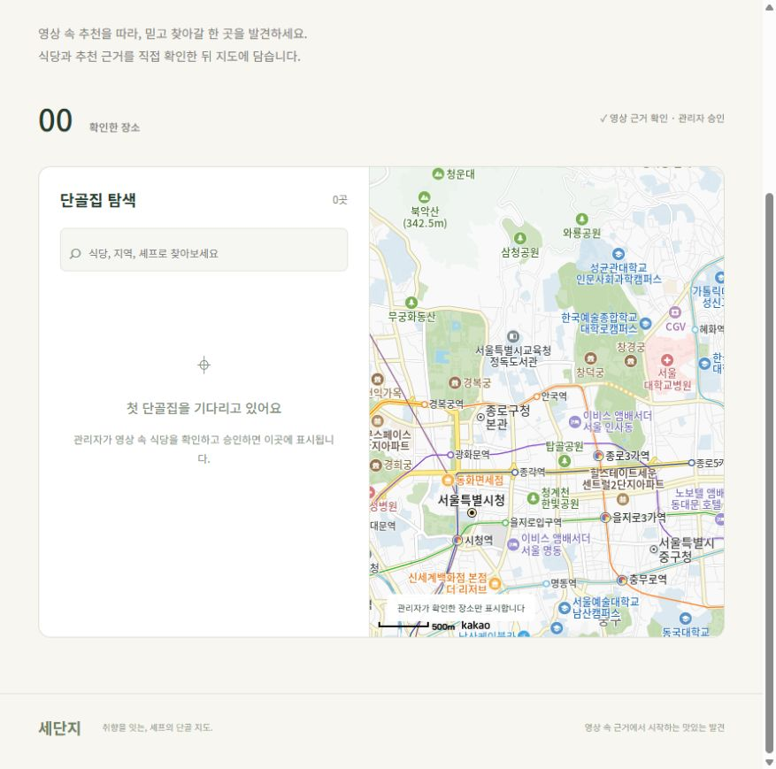
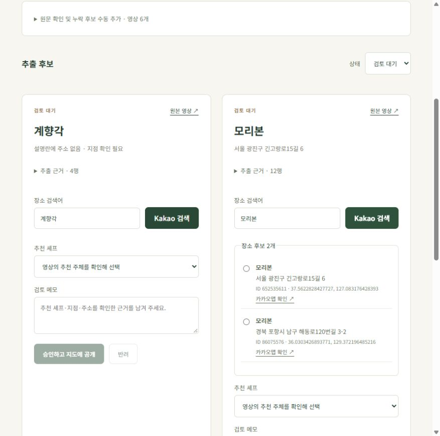

# 첫 기능: 영상 후보 검토와 승인된 맛집 지도

구현 및 검증일: 2026-10-22 (Asia/Seoul)

## 구현한 흐름

YouTube URL 입력 → 공식 API 설명란 확보 → 식당 후보와 원문 근거 저장 → 관리자 Kakao 검색 → 장소·지점·추천 셰프 확인 → 메모와 함께 승인 → PostgreSQL Restaurant/Mention 저장 → 공개 목록·지도 표시.

자동 추출과 공개 승인을 분리했다. PENDING Mention은 식당으로 공개하지 않는다. 셰프 이름은 채널명에서 추측하지 않고 관리자가 등록·선택한다. 반려는 식당을 만들지 않는다. 승인한 후보는 재승인을 막고, 검토자·시각·메모를 저장한다. 같은 Kakao ID는 식당 한 개로 합치고 여러 영상·셰프의 근거를 연결할 수 있다.

저장은 Spring JDBC와 PostgreSQL/Flyway를 사용했다. 핵심 모델은 Chef, Restaurant, Video, Mention이며, 서버가 실제 검색한 후보만 승인에 사용할 수 있도록 PlaceCandidate 스냅샷을 별도로 저장한다. 승인에는 DB 행 잠금을 사용한다.

## 실제 연결 검증

- Kakao PoC: 뽀요베리 `1158460117`, 모리본 서울 `652535611`의 ID·좌표 확보 성공. 모리본 포항 동명 후보는 주소 불일치로 제외했다. [상세 결과](POC_KAKAO_LOCAL.md).
- 공식 YouTube API로 원본과 추가 영상 5개, 총 6개 설명란을 확보했다. [추가 영상 한계](VIDEO_DESCRIPTION_VALIDATION.md).
- 실행 중인 Spring Boot API에 로컬 관리자 계정으로 실제 세션 로그인하고 6개 영상을 저장했다.
- 뽀요베리·모리본·주소 없는 계향각이 각각 별도 PENDING Mention으로 저장됐다.
- Spring Boot의 실제 Kakao 검색 결과는 뽀요베리 1개, 모리본 2개, 계향각 1개였다. 계향각은 후보가 하나라도 영상 설명란에 주소가 없으므로 동일 장소라고 확정하지 않았다.
- 가져오기와 후보 검색 전후 공개 식당은 0개로 동일했다. 실제 개발 DB에 자동 승인된 식당은 없다.
- 사용자 설정 JavaScript 키와 등록 도메인으로 **브라우저의 실제 Kakao 지도 SDK 및 지도 타일 로드**를 확인했다.
- 브라우저에서도 로그인과 모리본의 서울/포항 두 장소 후보 표시, 승인 조건이 채워지지 않았을 때 승인 버튼 비활성화를 확인했다.

개발 검증 JSON: `results/api-smoke.json`(Git 제외). `python scripts/smoke-api.py`로 재현한다. 실제 공개 승인 및 마커 생성의 데이터 경로는 아래 PostgreSQL 통합 테스트와 지도 SDK 모의 테스트로 검증했다. 실제 개발 DB의 식당을 임의 승인해 지도에 채우지는 않았다.

## 테스트 결과

| 검증 | 결과 | 외부 서비스 사용 여부 |
| --- | --- | --- |
| Python 기존 PoC | 30개 통과 | API 모의 응답/로컬 로직 |
| Java 추출·URL·실제 설명란 회귀 | 6개 통과 | 고정 설명란 5개 포함, 추가 호출 없음 |
| Spring Boot 통합 테스트 | 11개 통과 | 실제 PostgreSQL 17 테스트 DB, YouTube/Kakao 모의 응답 |
| React 및 Kakao 좌표 전달 | 5개 통과 | API/지도 SDK 모의 응답 |
| 전체 자동 테스트 합계 | **52개 통과, 실패 0개** | 실제 API 호출과 구분 |
| 프론트엔드 프로덕션 빌드 | 성공 | Vite 7.3.7 |
| npm 의존성 검사 | 설치 완료 시 전체 0건, 최종 런타임 검사 0건 | 레지스트리 검사 |
| 실제 API·DB 연결 및 브라우저 지도 | 성공 | 별도의 실제 검증 |

통합 테스트 항목: 승인 전 공개 차단, 영상 재입력 중복 방지, 원문 보존, 승인 후 공개 조회, 검토자 저장, 재승인 409, 미검색 장소 승인 차단, 반려 시 식당 미생성, 비로그인·CSRF 차단, 실제 비밀번호 로그인 및 오입력 거절, API 실패 시 DB 미저장, 같은 장소 중복 제거, 수동 근거 원문 포함 검사, 빈 승인 메모 차단.

테스트 DB는 `sedanji_test`이고 테스트별 쓰기는 롤백한다. `results/backend-tests.log`, `results/frontend-tests.log`, `results/frontend-build.log`은 Git 제외 로그다. 초기 실서버 점검에서 비밀번호 인코딩 식별자 누락을 발견해 수정했고, 실제 로그인 회귀 테스트 및 실서버·브라우저 로그인을 통해 재검증했다.

## 화면

승인된 식당이 아직 없어 빈 목록이지만 실제 Kakao 지도는 로드된 상태다.

주소 없는 계향각은 검토 대기로 남기고, 모리본의 서울/포항 후보를 나란히 검토한다.

## 실행과 남은 범위

[README](../README.md)에 `.env` 설정, Docker/PostgreSQL, Spring Boot, React 실행 명령, API와 테스트 방법을 기록했다. 현재 개발 URL은 `http://localhost:5173`, API는 `127.0.0.1:8090`, PostgreSQL은 `127.0.0.1:55432`다.

추출은 제한된 규칙이며 지도 모음 링크의 목적지 분석, 자막/영상 수집, 추천 주체의 자동 판별, 주소 지오코딩은 구현하지 않았다. 관리자가 근거를 확인해 승인해야 한다. 출시를 위한 다중 관리자 계정·로그인 시도 제한·HTTPS·승인 취소·페이징 등은 후속 범위다. 이번 작업은 로컬 첫 기능이며 외부 배포·커밋·푸시는 수행하지 않았다.
